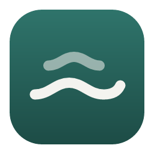
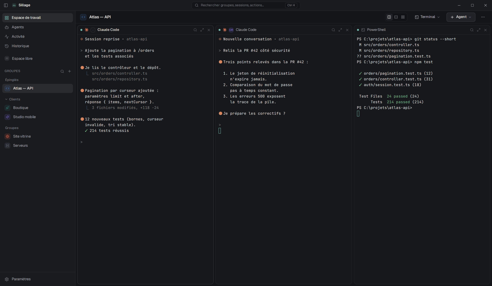
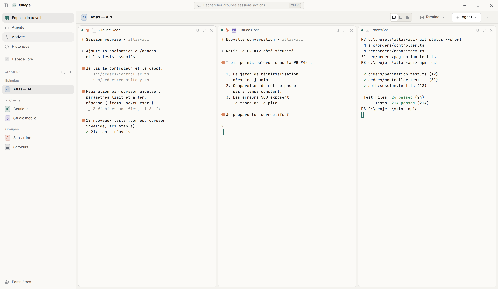
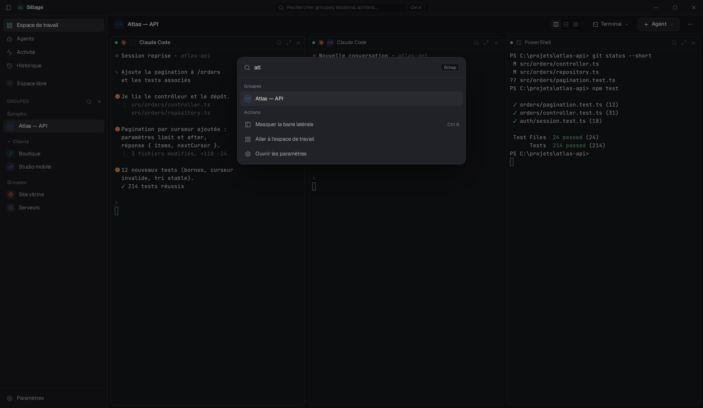
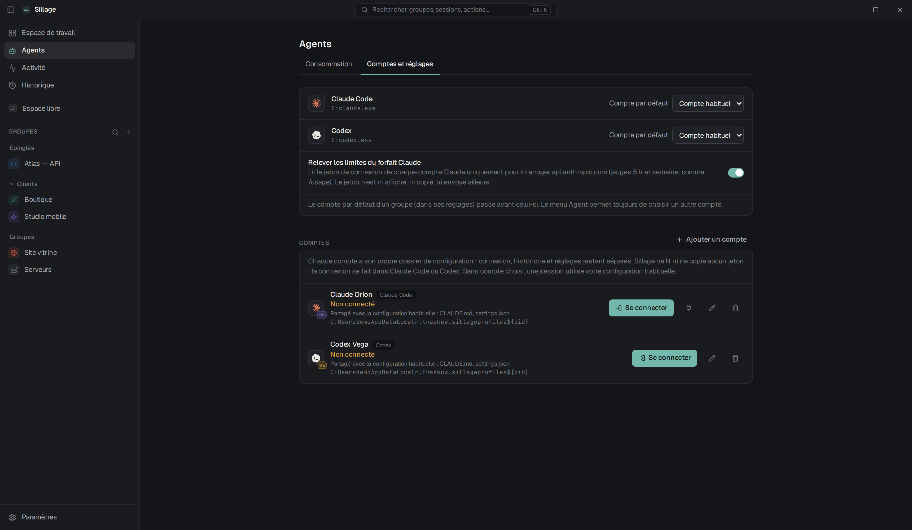
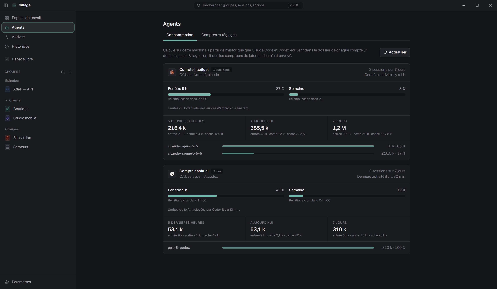
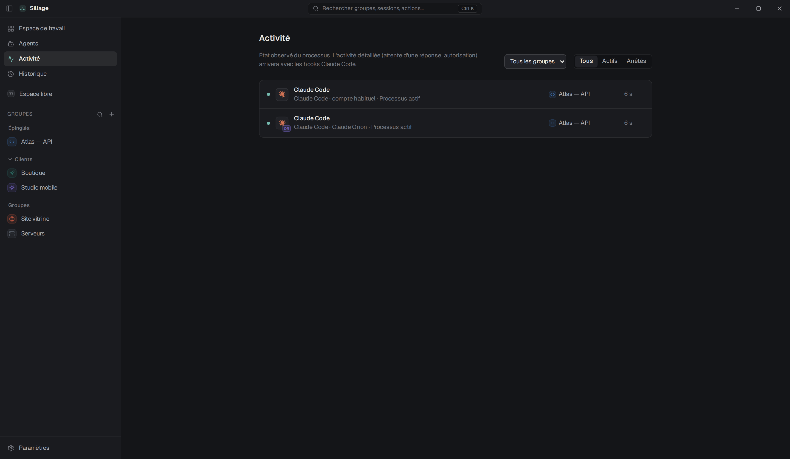

<div align="center">



# Sillage

**Tous vos agents IA et vos terminaux, dans un seul espace de travail.**
Claude Code, Codex, PowerShell et WSL côte à côte, rangés par projet, avec plusieurs comptes et leur consommation
sous les yeux. Local, rapide, sans cloud.

[](https://github.com/Thaskow/sillage/releases/latest)
[](https://github.com/Thaskow/sillage/releases)
[](https://github.com/Thaskow/sillage/actions/workflows/ci.yml)
[](LICENSE)
[](https://github.com/Thaskow/sillage/releases/latest/download/Sillage_x64-setup.exe)
[](#télécharger)

[**Télécharger pour Windows**](https://github.com/Thaskow/sillage/releases/latest/download/Sillage_x64-setup.exe) ·
[Guide d'utilisation](docs/guide.md) ·
[Confidentialité](docs/security.md) ·
[Feuille de route](docs/roadmap.md)

<br>



</div>

## Pourquoi Sillage

Quand on travaille avec des agents de code, on finit avec dix fenêtres de terminal, des onglets perdus, deux comptes
Claude qu'on jongle à la main et aucune idée de ce qu'il reste dans le forfait. Sillage remet de l'ordre :

- **Un groupe par projet** : chaque projet garde ses sessions (agents et terminaux), sa disposition et son compte
  par défaut. On passe de l'un à l'autre en un clic, rien ne s'arrête en arrière-plan.
- **Plusieurs comptes, sans bricolage** : un compte Claude perso et un compte pro, un compte Codex : chacun reste
  isolé, et un badge coloré indique toujours lequel travaille dans quel panneau.
- **La consommation sous les yeux** : jetons consommés et limites du forfait (fenêtre de 5 h et semaine) pour chaque
  compte.
- **Rien n'est perdu** : fermez Sillage, rouvrez-le : les sessions reprennent, conversations comprises.
- **Local d'abord** : pas de compte Sillage, pas de serveur, pas de télémétrie. Vos données restent sur votre machine.

## Fonctionnalités

### Groupes, espace libre et panneaux



- Groupes avec couleur, icône, catégories, épinglage et archivage ; réorganisation par glisser-déposer.
- **Espace libre** permanent pour lancer un terminal ou un agent sans rien configurer, puis l'**exporter** vers un
  groupe existant ou nouveau.
- Panneaux côte à côte, empilés ou en grille, redimensionnables, avec agrandissement d'un panneau.
- Vrais terminaux (ConPTY + xterm.js) : PowerShell, PowerShell 7, invite de commandes, WSL, Claude Code, Codex.
  Recherche dans le terminal, liens cliquables, copier-coller au clic droit.
- Thèmes clair et sombre, densité compacte, palette de commandes (`Ctrl K`).



### Comptes multiples Claude Code et Codex



- Chaque compte a son propre dossier de configuration (`CLAUDE_CONFIG_DIR`, `CODEX_HOME`) : connexion et historique
  séparés, connexion par la procédure officielle de l'outil.
- **Configuration partagée** en option : `CLAUDE.md`, réglages, skills, agents, commandes et plugins restent communs
  à tous vos comptes. Copie de vos serveurs MCP en un clic.
- Compte par défaut global et par groupe ; choix du compte à l'ouverture de chaque session.


### Consommation et limites du forfait



- Jetons consommés sur 5 h, aujourd'hui et 7 jours, répartis par modèle, calculés depuis l'historique local.
- Jauges des limites du forfait (fenêtre de 5 h et semaine) pour Claude et Codex, avec l'heure de réinitialisation.

### Activité et reprise



- Tous les agents de tous les groupes, filtrables par groupe et par état.
- Au redémarrage, les sessions actives sont relancées : Claude Code reprend sa conversation (`--resume`), Codex
  aussi (`codex resume`), les terminaux repartent dans leur dossier.

### Mises à jour

Sillage vérifie les nouvelles versions publiées ici et propose de les installer en un clic. Chaque mise à jour est
signée et sa signature vérifiée avant installation.

## Télécharger

| Système | Fichier | État |
|---|---|---|
| Windows 10 / 11 (x64) | [`Sillage_x64-setup.exe`](https://github.com/Thaskow/sillage/releases/latest/download/Sillage_x64-setup.exe) | Stable |
| macOS Apple Silicon | [`Sillage_aarch64.dmg`](https://github.com/Thaskow/sillage/releases/latest/download/Sillage_aarch64.dmg) | Expérimental |
| macOS Intel | [`Sillage_x64.dmg`](https://github.com/Thaskow/sillage/releases/latest/download/Sillage_x64.dmg) | Expérimental |

Les empreintes SHA-256 de chaque fichier sont publiées avec la version (`SHA256SUMS.txt`).

**Windows** : l'installation se fait pour l'utilisateur courant, sans droits administrateur. L'installateur n'est
pas encore signé par un certificat de signature de code : Windows SmartScreen peut afficher « Windows a protégé
votre ordinateur » ; cliquez sur **Informations complémentaires** puis **Exécuter quand même**.

**macOS (expérimental)** : l'application n'est pas notarisée par Apple. Après l'avoir glissée dans Applications,
lancez une fois `xattr -dr com.apple.quarantine /Applications/Sillage.app` dans le Terminal. Les fonctions propres à
Windows (PowerShell, WSL, invite de commandes) sont remplacées par un terminal zsh.

Prérequis : [Claude Code](https://docs.anthropic.com/claude-code) et/ou [Codex](https://github.com/openai/codex)
installés pour les agents ; WebView2 (présent sur Windows 11).

## Raccourcis

| Raccourci | Action |
|---|---|
| `Ctrl K` | Palette de commandes |
| `Ctrl T` | Nouvelle session Claude Code (compte par défaut) |
| `Ctrl Maj T` | Nouveau terminal PowerShell |
| `Ctrl Maj N` | Nouveau groupe |
| `Ctrl W` | Fermer la session active |
| `Ctrl Tab` / `Ctrl Maj Tab` | Session suivante / précédente |
| `Ctrl 1` … `Ctrl 9` | Aller au groupe épinglé 1 à 9 |
| `Ctrl B` | Afficher ou masquer la barre latérale |
| `Ctrl Maj F` | Rechercher dans le terminal |

## Confidentialité

- Aucune télémétrie, aucun compte Sillage, aucun port réseau ouvert.
- Sillage ne contacte que GitHub (recherche de mises à jour) et `api.anthropic.com` (limites du forfait Claude) ;
  les deux se désactivent dans les réglages.
- Les jetons de connexion ne sont jamais copiés ni affichés. Le seul usage, désactivable, est la lecture du jeton
  Claude du compte pour interroger ses limites de forfait.

Le détail est dans [docs/security.md](docs/security.md) et [docs/data.md](docs/data.md).

## FAQ

**Sillage remplace-t-il Claude Code ou Codex ?** Non. Sillage les lance tels quels dans de vrais terminaux ; vous
gardez leurs fonctionnalités, leurs commandes et leurs mises à jour.

**Mes conversations passent-elles par Sillage ?** Non. Claude Code et Codex communiquent directement avec leurs
services ; Sillage n'en lit que les compteurs de jetons, localement.

**Puis-je utiliser mon compte habituel ?** Oui : sans compte choisi, une session utilise votre configuration
habituelle (`~/.claude`, `~/.codex`).

**Où sont mes données ?** Dans `%LOCALAPPDATA%\fr.thaskow.sillage\` (base SQLite et dossiers des comptes ajoutés).

## Compiler depuis les sources

Sur Windows avec Rust, Node 24 et les MSVC Build Tools :

```sh
npm ci
npm run tauri build
```

Ou depuis Linux par compilation croisée, dans l'image Docker fournie :

```sh
docker build -t sillage-builder tools/builder
docker run --rm -v "$PWD":/src -v sillage-cargo-registry:/usr/local/cargo/registry \
  -v sillage-xwin:/cache/xwin -v sillage-npm:/root/.npm sillage-builder bash -c '
  npm ci && npm run typecheck && npm test && cargo test -p sillage-core &&
  npm run tauri build -- --runner cargo-xwin --target x86_64-pc-windows-msvc'
```

Développement de l'interface seule : `npm run dev` puis `http://127.0.0.1:1420` (backend simulé, `?empty` pour
démarrer sans données). Les captures de ce README se régénèrent avec `scripts/screenshots.mjs`.

Architecture, publication des versions et contribution : [docs/architecture.md](docs/architecture.md),
[docs/releasing.md](docs/releasing.md), [CONTRIBUTING.md](CONTRIBUTING.md).

## Licence

MIT. Polices incluses : Geist et JetBrains Mono (SIL Open Font License 1.1).
Logos Claude ([Simple Icons](https://simpleicons.org), CC0) et Codex ([Lobe Icons](https://github.com/lobehub/lobe-icons), MIT),
utilisés pour désigner ces outils ; les marques appartiennent à leurs détenteurs. Sillage n'est affilié ni à
Anthropic ni à OpenAI.
